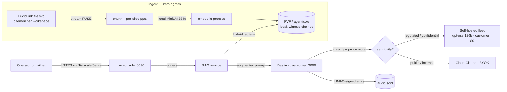

# Architecture

Every component the Sovereign AI Stack runs, and *why* it is there. The organising idea:
a single governor decides sensitivity and routing for every request; everything else
either feeds that governor sovereign context or proves, after the fact, that its decisions
held.

All of it runs **in-boundary** on an on-premises Nutanix lab (control plane host referred
to here as `bastion-01`). The only path in for an operator is a Tailscale-authenticated
HTTPS route; the only path out for regulated content is *no path* — it is answered
in-boundary.

---

## 1. Bastion — the trust router (`:3000`)

Bastion is a self-hosted, OpenAI-compatible `/v1` gateway. Every model call in the stack
goes through it. It is the point at which sovereignty is *established*: the decision that
keeps regulated content in-boundary is made here, once, auditable.

What it does on each request:

- **Sensitivity classification** — labels the request (public / internal / confidential /
  regulated) from content, not just metadata.
- **Policy routing** — `routingStrategy = sovereignty`: regulated/confidential work is
  pinned to an in-boundary model; public/internal work may use a more capable cloud model.
- **PII handling** — native Presidio detection/redaction on the request path.
- **Governed web search** — a self-hosted SearXNG path so "search" does not become an
  ungoverned egress.
- **MCP RBAC** — tool calls over the Model Context Protocol are role-gated, so an agent
  cannot reach a tool it was not granted.
- **Signed audit** — every decision is written to an HMAC-signed audit chain
  (`audit.jsonl`) with per-entry hashes, so the record can be verified rather than merely
  trusted.
- **BYOK** — the cloud provider key (Anthropic) lives only in a root-only environment file
  on the host, never in the application or this repository.

Why it's here: without a single governor over the augmented prompt, sovereignty is a
policy document, not an architecture. Bastion makes "regulated stays in-boundary" a
mechanical guarantee with a receipt.

## 2. The self-hosted model fleet

Real capability inside the boundary, so that "stay in-boundary" is not a downgrade to a
toy model.

| Model | Host (role) | Boundary | Use |
|-------|-------------|----------|-----|
| `gpt-oss:120b` | `ba71` — pinned resident (`OLLAMA_KEEP_ALIVE=-1`) | customer | Default in-boundary model; answers regulated/confidential work |
| `qwen2.5-32b`, `llama-3.1-70b` | `spark-47d8` | customer | Additional in-boundary capacity |
| `qwen2.5-7b` (+ small local models) | Nutanix RTX 2000 Ada VM (`nutanix-ada`) | customer | Lightweight in-boundary inference on the GPU-passthrough VM |
| `claude-opus` (frontier) | Cloud, **BYOK** | third_party | Public/internal work only — never regulated |

The fleet is registered in Bastion so the router can pick by capability *and* boundary.
`gpt-oss:120b` is held resident so the sovereign path has no cold-start penalty.

## 3. LucidLink in-boundary file service

The source documents live in LucidLink filespaces. Rather than bulk-copying them into the
boundary, the stack runs a **dedicated in-boundary file service** that streams LIST/READ
over a FUSE mount.

Key design point — **one daemon per workspace.** The LucidLink SDK daemon is
single-workspace; pointing one daemon at a second workspace crashes the native library.
So each workspace gets its own container/daemon and FUSE mount:

- `lucidlink-fileservice` (`:8000`) → the `my-cloud` workspace
- `lucidlink-fs-media` (`:8001`) → the `media` workspace

The token is supplied **per request** (`Authorization: Bearer <sa_live token>`), and the
target filespace via the `X-LucidLink-Filespace` header — nothing is baked into the image.
See [`../lucidlink/README.md`](../lucidlink/README.md).

Why it's here: it brings enterprise data *to* the boundary as a stream, keeping at-rest
copies minimal, and it is the source layer the RAG pipeline reads from.

## 4. The zero-egress RAG pipeline (`rag-service/`)

The path that turns a private document into a governed, cited answer without the raw text
ever leaving the boundary.

1. **Stream** (`ingestlib.mjs`) — walk a filespace via the in-boundary file service
   (breadth-first, so shallow/important documents are captured first), reading each file
   over FUSE. Connection drops mid-walk are ridden out with retry-and-backoff.
2. **Extract & chunk** — PowerPoint decks (OOXML) are parsed **per slide**; text documents
   are windowed with overlap. Legacy binary `.ppt` and pure media are catalogued by
   metadata (or skipped) rather than wastefully streamed. Every embedded chunk is prefixed
   with its `[deck/filename]` so topic and filename queries land on the right document.
3. **Embed locally** (`embed.mjs`) — RuVector's ONNX MiniLM (`all-MiniLM-L6-v2`, 384-dim,
   pure-WASM/SIMD) runs **in-process**. This is the first sovereignty gate: raw text is
   vectorized locally and never sent out to an embedding API.
4. **Store** (RVF / agenticow) — vectors + a citation sidecar are written to a per-source
   `*.rvf` store, tagged with the sensitivity label.
5. **Retrieve** (`retrieval.mjs`) — hybrid: dense cosine + multi-field BM25 (filename
   weighted) fused with Reciprocal Rank Fusion, a phrase/bigram boost, MMR de-duplication,
   and a distance threshold. (No cross-encoder reranker on the hot path — grounded on the
   trade-off that a CE adds ~30 MB and ~25× latency for marginal gain at this scale.)
6. **Augment & govern** (`ask.mjs` / `rag.mjs`) — the top chunks are placed into the prompt
   and sent to **Bastion `/v1`**. Because the retrieved text now rides in the prompt,
   Bastion's sensitivity classification governs the whole answer: a regulated corpus forces
   `gpt-oss-120b` on the `customer` boundary at $0, with inline `【source†n】` citations.

This is the second — and decisive — sovereignty gate: the governor sees the augmented
prompt, so retrieved confidential content cannot be answered by a cloud model.

### Request / data flow

## 5. RuVector RVF + agenticow — the sovereign memory

The vector store is **RuVector RVF**: a single-file HNSW index that is witness-chained for
provenance. It is wrapped by **agenticow** ("Git for agent memory"), which adds
copy-on-write branching:

- **Branch/checkpoint** in ~0.5 ms and ~162 bytes regardless of base size — so a risky
  ingest can be staged on a branch and promoted or discarded.
- **Exact read-through** queries merge the lineage chain (parent ∪ child edits, child wins
  on collision, deletions honoured).
- **`lineage()`** gives a provenance/compliance trail; dropping a branch is a surgical
  **GDPR right-to-erasure** without re-indexing.

Honestly scoped: a single ANN/HNSW index that *spans* the COW boundary is on the agenticow
roadmap, not shipped — the current wrapper does an exact read-through merge across the
lineage. This is called out in agenticow's own source and we do not claim otherwise.

Why it's here: sovereign memory needs two properties the stack actually uses —
**provenance you can reconstruct** and **data you can surgically erase** — both without a
cloud vector database.

## 6. The unified live console (`:8090`, tailnet-only)

One page — Overview (KPIs from the real audit chain), Fleet (models from Bastion's
registry), Policy (sovereignty strategy + tiers), Audit (signed chain with real hashes),
and the Knowledge/RAG workflow (Connections, ingest, library, retrieval preview, ask). It
is served **same-origin** by the RAG service so the page and its API share one origin.

Exposure: the service binds **loopback only** (`127.0.0.1:8090`) and is fronted by
**Tailscale Serve** — a tailnet-only HTTPS route (`https://bastion-01.<tailnet>.ts.net/`),
**not** a public Funnel. The LAN cannot reach it; only the operator's own tailnet devices
can. See [`../deploy/README.md`](../deploy/README.md).

---

*The consistent pattern: sovereignty is established once (at the governor), fed by a
pipeline that vectorizes locally, recorded in memory that can prove and erase, and operated
through a surface that never leaves the tailnet.*
